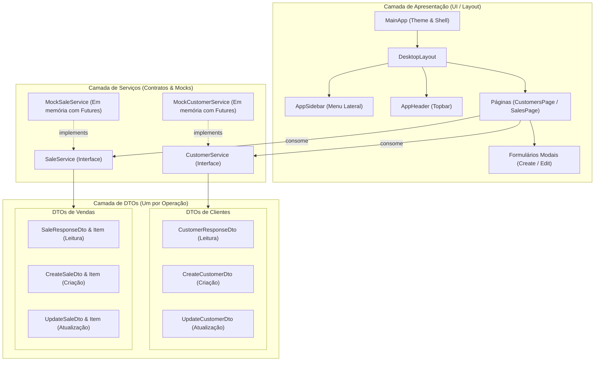

# Plano de Implementação - Backoffice de Vendas Desktop-like

Transformação da aplicação Flutter em um sistema de backoffice de vendas com interface desktop, contendo menu lateral de navegação, módulos de CRUD de Clientes e Vendas, arquitetura em camadas clara (DTOs segregados por operação, Services, Layout, Pages) e dados mockados assíncronos preparados para futura integração via API HTTP, utilizando apenas gerenciamento de estado nativo do Flutter (`StatefulWidget`/`setState`).

---

## 1. Visão Geral da Arquitetura

A aplicação adotará o padrão de **DTO por operação** (Request/Response segregados para cada caso de uso: Criação, Atualização e Leitura), preparando perfeitamente a base para a futura integração com endpoints REST:



---

## 2. Estrutura de Diretórios com DTO por Operação

```
lib/
├── dtos/
│   ├── customers/
│   │   ├── customer_response_dto.dart  # Dados retornados nas listagens/consultas
│   │   ├── create_customer_dto.dart    # Payload enviado na criação de novo cliente
│   │   └── update_customer_dto.dart    # Payload enviado na atualização de cliente existente
│   └── sales/
│       ├── sale_response_dto.dart      # Venda e itens retornados nas consultas
│       ├── create_sale_dto.dart        # Payload de criação de venda (com CreateSaleItemDto)
│       └── update_sale_dto.dart        # Payload de alteração de venda (com UpdateSaleItemDto)
├── services/
│   ├── customer_service.dart           # Contrato abstrato do serviço de clientes
│   ├── mock_customer_service.dart      # Implementação mock assíncrona em memória
│   ├── sale_service.dart               # Contrato abstrato do serviço de vendas
│   └── mock_sale_service.dart          # Implementação mock assíncrona em memória
├── layout/
│   ├── desktop_layout.dart             # Shell desktop (Sidebar + Header + Body)
│   ├── app_sidebar.dart                # Componente do menu lateral
│   └── app_header.dart                 # Barra superior com título e perfil
├── pages/
│   ├── customers/
│   │   ├── customers_page.dart         # Listagem de clientes com busca e ações
│   │   └── customer_form_dialog.dart   # Modal de criação/edição de cliente
│   └── sales/
│       ├── sales_page.dart             # Listagem de vendas com filtros e ações
│       └── sale_form_dialog.dart       # Modal de criação/edição de venda
├── widgets/
│   ├── status_badge.dart               # Badge colorido para status (Ativo, Pendente, etc.)
│   └── confirm_dialog.dart             # Diálogo padrão de confirmação de exclusão
└── main.dart                           # Configuração do app e tema desktop moderno
```

---

## 3. Especificação dos DTOs por Operação

### 3.1 Clientes (`lib/dtos/customers/`)
1. **`CreateCustomerDto`**:
   - Campos: `String name`, `String email`, `String phone`, `String document`.
   - Método: `toJson()`, validação básica.
2. **`UpdateCustomerDto`**:
   - Campos: `String id`, `String name`, `String email`, `String phone`, `String document`, `String status`.
   - Método: `toJson()`.
3. **`CustomerResponseDto`**:
   - Campos: `String id`, `String name`, `String email`, `String phone`, `String document`, `String status`, `DateTime createdAt`.
   - Método: `fromJson(Map<String, dynamic> json)`, `toJson()`.

### 3.2 Vendas (`lib/dtos/sales/`)
1. **`CreateSaleDto`** e **`CreateSaleItemDto`**:
   - `CreateSaleItemDto`: `String description`, `int quantity`, `double unitPrice`.
   - `CreateSaleDto`: `String customerId`, `List<CreateSaleItemDto> items`, `String status` (padrão 'Pendente').
   - Método: `toJson()`.
2. **`UpdateSaleDto`** e **`UpdateSaleItemDto`**:
   - `UpdateSaleItemDto`: `String? id`, `String description`, `int quantity`, `double unitPrice`.
   - `UpdateSaleDto`: `String id`, `String customerId`, `List<UpdateSaleItemDto> items`, `String status`.
   - Método: `toJson()`.
3. **`SaleResponseDto`** e **`SaleItemResponseDto`**:
   - `SaleItemResponseDto`: `String id`, `String description`, `int quantity`, `double unitPrice`, `double totalPrice`.
   - `SaleResponseDto`: `String id`, `String customerId`, `String customerName`, `DateTime saleDate`, `List<SaleItemResponseDto> items`, `double totalAmount`, `String status`.
   - Métodos: `fromJson(Map<String, dynamic> json)`, `toJson()`.

---

## 4. Contratos dos Serviços (`lib/services/`)

### `CustomerService`
```dart
abstract class CustomerService {
  Future<List<CustomerResponseDto>> getAll({String? query});
  Future<CustomerResponseDto?> getById(String id);
  Future<CustomerResponseDto> create(CreateCustomerDto dto);
  Future<CustomerResponseDto> update(UpdateCustomerDto dto);
  Future<bool> delete(String id);
}
```

### `SaleService`
```dart
abstract class SaleService {
  Future<List<SaleResponseDto>> getAll({String? statusFilter, String? query});
  Future<SaleResponseDto?> getById(String id);
  Future<SaleResponseDto> create(CreateSaleDto dto);
  Future<SaleResponseDto> update(UpdateSaleDto dto);
  Future<bool> delete(String id);
}
```

As implementações mock (`MockCustomerService` e `MockSaleService`) manterão seus dados internos em memória e mapearão as entradas `Create...Dto` e `Update...Dto` para `...ResponseDto`, simulando exatamente o comportamento de um backend REST com latência simulada (`Future.delayed`).

---

## 5. Layout Desktop e Telas

- **Shell Desktop (`DesktopLayout`)**:
  - Menu lateral estilizado com branding "Backoffice Vendas", seleção de páginas com destaque visual, ícones intuitivos e área de navegação fixa.
  - Cabeçalho superior com título dinâmico da página atual e avatar/perfil mockado do operador.
- **Página de Clientes (`CustomersPage`)**:
  - Tabela desktop com colunas para ID, Nome, E-mail, Telefone, Documento, Status e Ações.
  - Filtro em tempo real por nome/documento.
  - Diálogo modal para criação (`CreateCustomerDto`) ou edição (`UpdateCustomerDto`).
- **Página de Vendas (`SalesPage`)**:
  - Tabela desktop com ID, Cliente, Data, Qtd Itens, Valor Total, Status e Ações.
  - Filtro por status (`Todos`, `Pendente`, `Faturada`, `Cancelada`) e busca textual.
  - Diálogo modal permitindo selecionar o cliente, adicionar múltiplos itens de venda dinamicamente com cálculo em tempo real e salvar (`CreateSaleDto` / `UpdateSaleDto`).
- **Sem Bibliotecas Externas de Estado**:
  - Uso de `StatefulWidget` com `setState` para carregamento, filtragem e atualização reativa das tabelas após operações CRUD.

---

## 6. Plano de Verificação

### Automatizado
- Testes unitários cobrindo o fluxo de criação, consulta, atualização e exclusão com os DTOs específicos (`test/customer_service_test.dart`, `test/sale_service_test.dart`).
- Validação estática completa com `flutter analyze`.
- Execução de todos os testes com `flutter test`.

### Manual
- Navegação entre as abas do menu lateral.
- Criação de novo cliente e conferência na tabela.
- Edição de cliente existente e checagem de alteração de status/dados.
- Criação de venda associada ao cliente recém-criado, incluindo múltiplos itens e cálculo de total.
- Filtragem de vendas por status e cancelamento/exclusão com confirmação.
