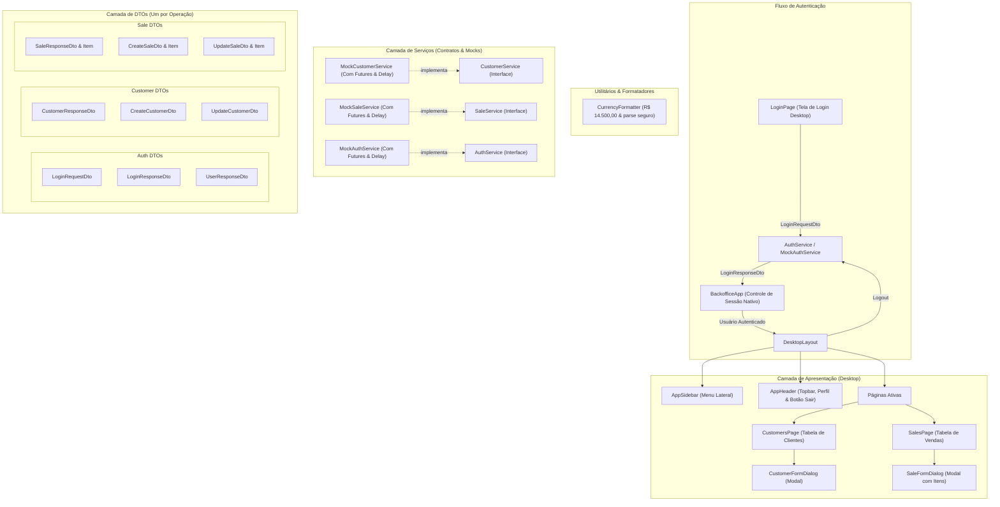

# Walkthrough - Backoffice de Vendas Desktop-like

Implementação completa de uma aplicação Flutter com visual e experiência **desktop-like** para backoffice de vendas corporativo, contando com **fluxo completo de autenticação (Login/Logout)**, **menu lateral de navegação**, **CRUD de Clientes**, **CRUD de Vendas com múltiplos itens e cálculo em tempo real**, **formatação de valores monetários no padrão brasileiro (BRL)**, **DTOs segregados por operação** (Login, Create, Update, Response), e **dados mockados assíncronos** desacoplados da interface e prontos para conexão com API REST futura sem necessidade de bibliotecas externas de estado.

---

## 1. Arquitetura Geral do Sistema



### Arquivos Criados e Modificados:

1. **Módulo de Autenticação (Login/Logout)**:
   - [`lib/dtos/auth/login_request_dto.dart`](file:///C:/dev/temp/birdle/lib/dtos/auth/login_request_dto.dart): DTO de payload de credenciais (`email`, `password`).
   - [`lib/dtos/auth/login_response_dto.dart`](file:///C:/dev/temp/birdle/lib/dtos/auth/login_response_dto.dart): DTO de resposta de autenticação contendo `token` e `UserResponseDto`.
   - [`lib/dtos/auth/user_response_dto.dart`](file:///C:/dev/temp/birdle/lib/dtos/auth/user_response_dto.dart): Modelo do usuário logado (`id`, `name`, `email`, `role`).
   - [`lib/services/auth_service.dart`](file:///C:/dev/temp/birdle/lib/services/auth_service.dart): Contrato assíncrono para autenticação (`login`, `logout`, `getCurrentUser`).
   - [`lib/services/mock_auth_service.dart`](file:///C:/dev/temp/birdle/lib/services/mock_auth_service.dart): Implementação mock validando credenciais (Admin, Vendas e senhas de teste).
   - [`lib/pages/auth/login_page.dart`](file:///C:/dev/temp/birdle/lib/pages/auth/login_page.dart): Tela de login elegante desktop corporativa com cartões de credenciais demonstrativas e feedback de erro.

2. **Formatação Monetária BRL**:
   - [`lib/utils/currency_formatter.dart`](file:///C:/dev/temp/birdle/lib/utils/currency_formatter.dart): Formatação padrão brasileiro (ex: `14500.5` -> `R$ 14.500,50`) e conversor/parse seguro de texto para valor monetário (`1.250,50` -> `1250.50`).

3. **DTOs de Clientes e Vendas**:
   - [`lib/dtos/customers/create_customer_dto.dart`](file:///C:/dev/temp/birdle/lib/dtos/customers/create_customer_dto.dart)
   - [`lib/dtos/customers/update_customer_dto.dart`](file:///C:/dev/temp/birdle/lib/dtos/customers/update_customer_dto.dart)
   - [`lib/dtos/customers/customer_response_dto.dart`](file:///C:/dev/temp/birdle/lib/dtos/customers/customer_response_dto.dart)
   - [`lib/dtos/sales/create_sale_dto.dart`](file:///C:/dev/temp/birdle/lib/dtos/sales/create_sale_dto.dart)
   - [`lib/dtos/sales/update_sale_dto.dart`](file:///C:/dev/temp/birdle/lib/dtos/sales/update_sale_dto.dart)
   - [`lib/dtos/sales/sale_response_dto.dart`](file:///C:/dev/temp/birdle/lib/dtos/sales/sale_response_dto.dart)

4. **Layout Desktop & Shell**:
   - [`lib/layout/app_sidebar.dart`](file:///C:/dev/temp/birdle/lib/layout/app_sidebar.dart): Menu lateral escuro corporativo (`#1E293B`) com badges e status de conexão.
   - [`lib/layout/app_header.dart`](file:///C:/dev/temp/birdle/lib/layout/app_header.dart): Barra superior exibindo nome do operador autenticado, papel (`Administrador`/`Vendedor`) e botão de logout.
   - [`lib/layout/desktop_layout.dart`](file:///C:/dev/temp/birdle/lib/layout/desktop_layout.dart): Shell principal com diálogo de confirmação para logout.
   - [`lib/main.dart`](file:///C:/dev/temp/birdle/lib/main.dart): Orquestração central de autenticação nativa sem bibliotecas externas.

---

## 2. Resultados dos Testes e Validação

### Testes Unitários Automatizados (`flutter test`)
Executados **16 testes** cobrindo autenticação, CRUD de clientes, CRUD de vendas e formatação de moeda:
```
00:00 +0: C:/dev/temp/birdle/test/auth_service_test.dart: MockAuthService Tests deve autenticar usuário administrador com sucesso
00:00 +1: C:/dev/temp/birdle/test/auth_service_test.dart: MockAuthService Tests deve autenticar usuário comercial com sucesso
00:00 +2: C:/dev/temp/birdle/test/auth_service_test.dart: MockAuthService Tests deve falhar ao informar senha incorreta
00:00 +3: C:/dev/temp/birdle/test/auth_service_test.dart: MockAuthService Tests deve realizar logout com sucesso e limpar sessão
00:00 +4: C:/dev/temp/birdle/test/currency_formatter_test.dart: CurrencyFormatter Tests deve formatar valores monetários corretamente para o padrão BRL
00:00 +5: C:/dev/temp/birdle/test/currency_formatter_test.dart: CurrencyFormatter Tests deve converter strings monetárias para double de forma segura
00:00 +6: C:/dev/temp/birdle/test/customer_service_test.dart: MockCustomerService Tests deve listar todos os clientes iniciais
00:00 +7: C:/dev/temp/birdle/test/customer_service_test.dart: MockCustomerService Tests deve filtrar clientes por termo de busca
00:00 +8: C:/dev/temp/birdle/test/customer_service_test.dart: MockCustomerService Tests deve criar um novo cliente com sucesso usando CreateCustomerDto
00:00 +9: C:/dev/temp/birdle/test/customer_service_test.dart: MockCustomerService Tests deve atualizar cliente existente usando UpdateCustomerDto
00:00 +10: C:/dev/temp/birdle/test/customer_service_test.dart: MockCustomerService Tests deve excluir cliente com sucesso
00:00 +11: C:/dev/temp/birdle/test/sale_service_test.dart: MockSaleService Tests deve listar todas as vendas iniciais
00:00 +12: C:/dev/temp/birdle/test/sale_service_test.dart: MockSaleService Tests deve filtrar vendas por status
00:00 +13: C:/dev/temp/birdle/test/sale_service_test.dart: MockSaleService Tests deve criar uma nova venda com múltiplos itens e calcular total correto
00:00 +14: C:/dev/temp/birdle/test/sale_service_test.dart: MockSaleService Tests deve atualizar venda existente usando UpdateSaleDto
00:00 +15: C:/dev/temp/birdle/test/sale_service_test.dart: MockSaleService Tests deve excluir venda com sucesso
00:00 +16: All tests passed!
```

### Análise Estática (`flutter analyze`)
```
Analyzing birdle...
No issues found! (ran in 1.3s)
```
Zero erros, zero warnings, zero deprecations.
